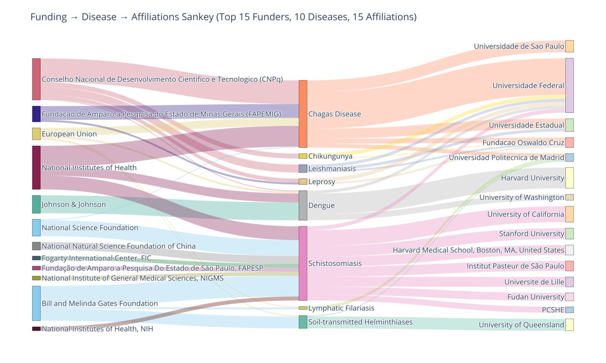
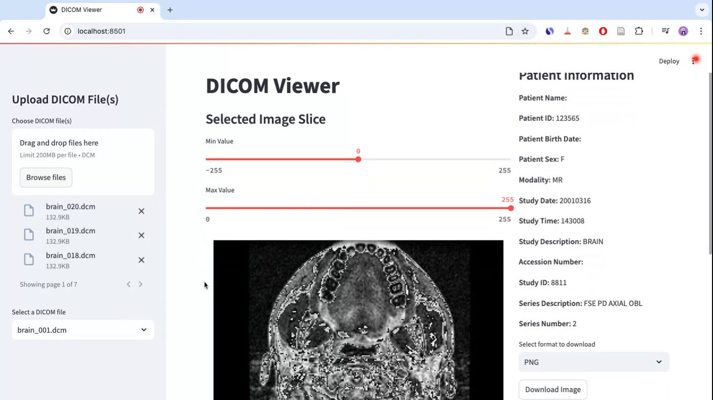
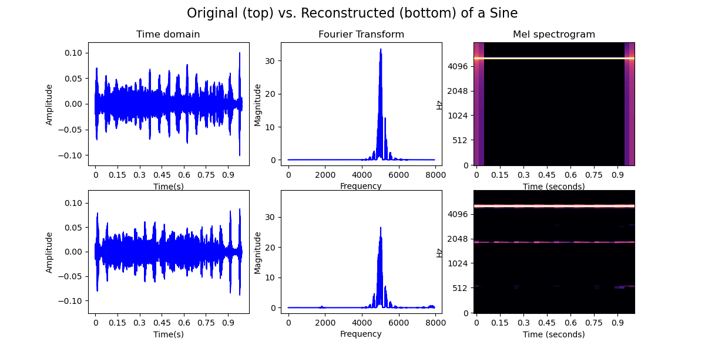
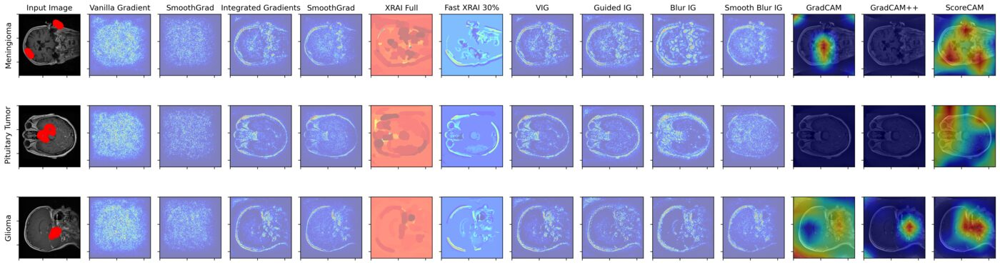
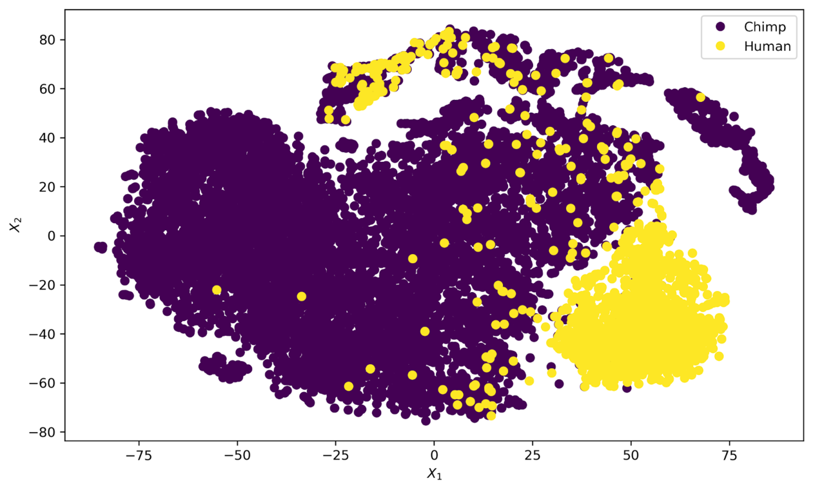
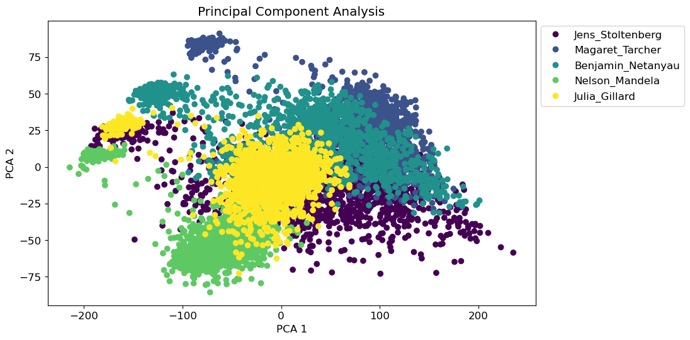

I am a biomedical AI researcher. I build trustworthy machine learning for medicine: models that learn robust, multimodal representations of imaging and clinical data, explain their decisions, and generalise to the settings where they are used, including low-resource health systems.

Since January 2025 I have been a **Biomedical AI Research Fellow** in a research collaboration with [Rhodes University](https://www.ru.ac.za/) and global academic partners, working on multimodal learning for early diagnosis and prognosis, and co-supervising students in medical imaging and clinical AI. I received my **Ph.D. in Cognitive Science** from [Osnabrück University](https://www.uni-osnabrueck.de/) in 2025 (advisors: Prof. Gunther Heidemann and Prof. Simone Pika), with a thesis on disentangled representation learning in speech and vocalization. Before that I studied at [AIMS Rwanda](https://aims.ac.rw/) (M.Sc. Mathematical Sciences), the [University of Dhaka](https://du.ac.bd/) (M.Sc. Computer Science and Engineering) and the [University of Makeni](https://unimak.edu.sl/) (B.Sc. Computer Science).

**Research interests:** medical image analysis · multimodal clinical AI · trustworthy and explainable AI · robustness and generalisation · representation learning · AI for global health.

<video class="lazy-video" src="/assets/media/group_007_gradcampp.mp4" data-poster="/assets/media/group_007_gradcampp-poster.jpg" muted loop playsinline preload="none" style="width:100%;" aria-label="Multimodal cross-attention visualization of Grad-CAM++ for a trained multimodal deep learning model for Alzheimer&#x27;s prediction on ADNI subjects."></video>

Multimodal cross-attention visualization of Grad-CAM++ for a trained multimodal deep learning model for Alzheimer's prediction on ADNI subjects.

Sankey diagram of research funding sources, disease areas, and institutional affiliations AI in Neglected Tropical Diseases (NTDs) between 2015 to 2025.

<video class="lazy-video" src="/assets/media/output.mp4" data-poster="/assets/media/output-poster.jpg" muted loop playsinline preload="none" style="width:100%;" aria-label="Jensen–Shannon divergence between two probability distributions."></video>

A web-based DICOM viewer enabling medical image visualization and basic manipulations, such as contrast adjustment, export to png and video (for multiple uploaded files).For more details, visit the project repository: <a href="https://github.com/yusufbrima/DICOMViewer">DICOMViewer</a>

Time-domain, frequency-domain and time-frequency representations of a sine waveform across different frequencies sampled at 16KHz for 1 seconds. The top row is the original signal and the bottom row is the reconstructed version for the disentangled Variational Auto Encoder.

<video class="lazy-video" src="/assets/media/sawtooth.mp4" data-poster="/assets/media/sawtooth-poster.jpg" muted loop playsinline preload="none" style="width:100%;" aria-label="Time-domain, time-frequency and frequency-domain representations of a sawtooth waveform across different frequencies sampled at 16KHz for 2 seconds."></video>

Time-domain, time-frequency and frequency-domain representations of a sawtooth waveform across different frequencies sampled at 16KHz for 2 seconds each.

<video class="lazy-video" src="/assets/media/mnist_tripplet_animation_advanced.mp4" data-poster="/assets/media/mnist_tripplet_animation_advanced-poster.jpg" muted loop playsinline preload="none" style="width:100%;" aria-label="Triplet-based contrastive representation learning of MNIST validation set."></video>

Visualizing the convergence of clusters of classes in the MNIST validation set using both Triplet (Left) and Supervised Contrastive Representation Learning

<video class="lazy-video" src="/assets/media/bt_small_train_modified_BN.mp4" data-poster="/assets/media/bt_small_train_modified_BN-poster.jpg" muted loop playsinline preload="none" style="width:100%;" aria-label="128-dimensional latent representation of modified Barlow Twins."></video>

<video class="lazy-video" src="/assets/media/bt_small_train_original.mp4" data-poster="/assets/media/bt_small_train_original-poster.jpg" muted loop playsinline preload="none" style="width:100%;" aria-label="128-dimensional latent representation of modified Barlow Twins."></video>

Visualizing the convergence of latent representations over training iterations for modified Barlow Twins model: decorrelated audio representations (left) and original small training data (right). The 128-dimensional latent space reveals the progression of learned features and their alignment throughout the training process.

<video class="lazy-video" src="/assets/media/KL_Divergence.mp4" data-poster="/assets/media/KL_Divergence-poster.jpg" muted loop playsinline preload="none" style="width:100%;" aria-label="Kullback–Leibler divergence between two probability distributions."></video>

<video class="lazy-video" src="/assets/media/JSD_Divergence.mp4" data-poster="/assets/media/JSD_Divergence-poster.jpg" muted loop playsinline preload="none" style="width:100%;" aria-label="Jensen–Shannon divergence between two probability distributions."></video>

A visual illustration of two divergence measures: the Kullback–Leibler (KL) and Jensen–Shannon (JS) divergences between two probability distributions $P_x $ and $Q_x$.

Explainable AI in Medical Image Analysis using Visual Saliency Maps. Feature attribution was done with a trained InceptionResNetv2 model.

<video class="lazy-video" src="/assets/media/1.mp4" data-poster="/assets/media/1-poster.jpg" muted loop playsinline preload="none" style="width:100%;" aria-label="Workshop Poster Presentation"></video>

Learnt 2D and 3D principal component latent representations of both human and non-human primates.

<video class="lazy-video" src="/assets/media/3.mp4" data-poster="/assets/media/3-poster.jpg" muted loop playsinline preload="none" style="width:100%;" aria-label="Workshop Poster Presentation"></video>

Learnt 2D and 3D principal component latent representations of speeches at the United States Congress by five world leaders.

